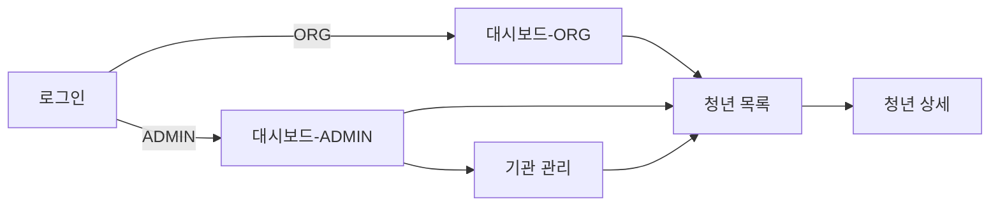

클로드 작성
# Phase 1 와이어프레임 계획

## 1. 목적

로그인 / 청년 목록 / 청년 상세 / 대시보드 / 기관 관리 5개 화면의 구조를 피그마에 저해상도 와이어프레임으로 먼저 잡는다.

색상·폰트 등 비주얼 디테일은 다루지 않는다. shadcn/Tailwind 컴포넌트가 이미 선택돼 있으므로, 디테일은 Phase 3 프론트 구현 때 코드에서 바로 정한다. 이 단계에서 정하는 건 **화면에 뭐가 들어가는지, 화면끼리 어떻게 연결되는지**뿐이다.

대상 디바이스는 **데스크톱 전용**이다. 기관 담당자가 PC로 쓴다고 가정하고, 태블릿·모바일 반응형은 범위 밖으로 둔다.

피그마 파일: [한걸음 관리자 웹](https://www.figma.com/design/1WKpWaTB7VrEmuVB5QW1rB/한걸음-관리자-웹)

## 2. 화면 ↔ 유스케이스 매핑

| 화면 | 액터 | 대응 유스케이스 |
|---|---|---|
| 로그인 | ADMIN, ORG | UC-01, UC-02 |
| 청년 목록 | ADMIN, ORG | UC-07 |
| 청년 상세 | ADMIN, ORG | UC-08, UC-09, UC-10 |
| 대시보드 | ORG | UC-12 |
| 대시보드 | ADMIN | UC-13 |
| 기관 관리 | ADMIN | UC-03, UC-04, UC-05, UC-06, UC-11, UC-15 |

ADMIN과 ORG는 로그인 이후 보는 대시보드 내용이 달라서(UC-12 vs UC-13), 같은 "대시보드" 화면이라도 피그마에서는 프레임을 2개로 나눈다.

## 3. 작업 순서 (제안)

로그인 → 청년 목록 → 청년 상세 → 대시보드(ORG/ADMIN) → 기관 관리

사용자가 로그인 이후 실제로 거치는 흐름 순서와 같다. 기관 관리는 ADMIN만 쓰고 빈도도 낮은 화면이라 마지막에 둔다.

## 4. 네비게이션 흐름

기관 관리(배정 포함)에서 청년 목록으로 돌아가는 경로를 열어둔다. UC-11(청년 배정)이 기관 관리 화면에서 일어나기 때문이다.

## 5. 화면별 메모

### 로그인
- 이메일/비밀번호 입력, 에러 메시지 영역(UC-01 실패 분기)

### 청년 목록
- 필터(UC-07 3a), 정렬 기준은 마지막 접속일 내림차순 고정(UC-07 4)
- ADMIN은 기관 필터가 추가로 보임(UC-07 3b)
- 빈 목록 상태(UC-07 3c)

### 청년 상세
- 기본 정보, 고립도 추이 그래프(UC-10), 퀘스트 이력(UC-09)
- confirm_answer는 복호화된 값이 그대로 노출되는 화면이라, 열람 시점에 UC-08 4번(로그 기록)이 걸린다는 점을 레이아웃과 별개로 염두에 둔다

### 대시보드 (ORG)
- 소속 청년 통계 요약, 미접속 청년 강조(UC-12)

### 대시보드 (ADMIN)
- 기관별 현황 비교(UC-13)

### 기관 관리
- 기관 등록(UC-03), 계정 생성(UC-04), 기관 목록(UC-05), 계정 비활성화(UC-06)
- 청년 배정(UC-11)
- 동기화 상태/이력(UC-15)도 같은 화면에 포함한다. 한 프레임 안에서 등록·계정관리·배정과는 구분되는 섹션으로 둔다

## 6. 피그마 파일 구성

Page 1 안에 화면당 프레임 하나씩, 이름은 `00-로그인`, `01-청년목록`, `02-청년상세`, `03-대시보드-ORG`, `04-대시보드-ADMIN`, `05-기관관리` 순서로 둔다.

프레임 크기는 데스크톱 기준(폭 1440px)으로 통일한다.

## 7. 완료 조건

- [ ] 6개 프레임이 피그마에 존재
- [ ] 각 화면에 5번 메모의 요소가 레이아웃으로 반영됨
- [ ] 화면 간 이동 경로가 4번 플로우와 일치
